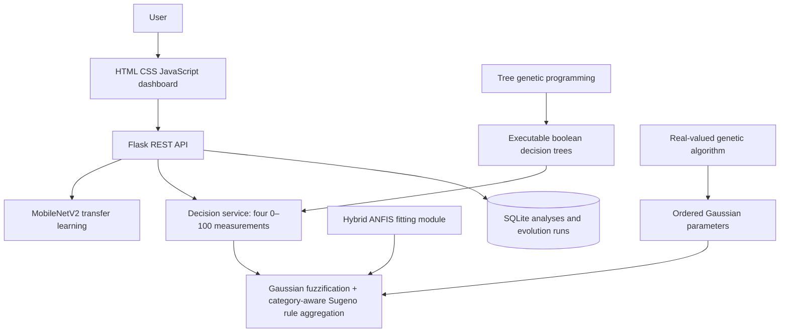
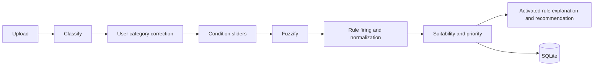
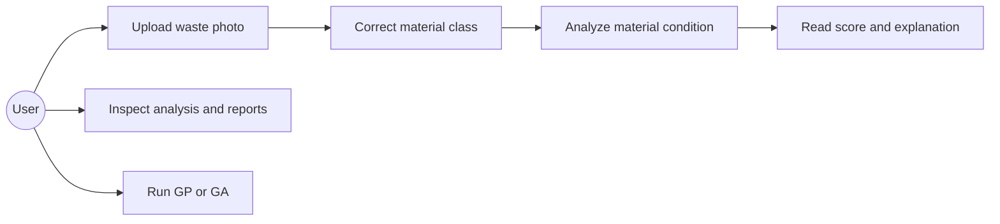
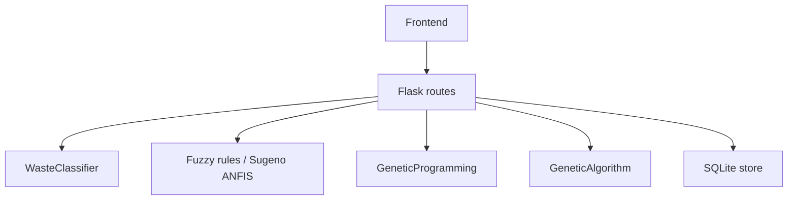

# Architecture and algorithm notes

## Methods

- **Gaussian membership:** `μ(x;c,σ) = exp(-0.5 ((x-c)/σ)^2)` with `c∈[0,100]`, `σ∈[1,60]`.
- **Fuzzy inference:** antecedent conjunction uses minimum firing, normalized firing strengths form the weights, and first-order weighted consequents yield crisp suitability and priority independently. Rules with a category condition have zero firing for other categories.
- **ANFIS:** three selected rules avoid a 3⁴ grid. Consequent coefficients are estimated by least squares; premise parameters receive bounded finite-difference gradient updates. Training requires an explicit numeric target, not labels invented by the application.
- **GP:** a tree node is an executable boolean or comparison expression. Tournament selection and elitism preserve strong trees; generated subtrees supply variation. Fitness combines accuracy and a size penalty.
- **GA:** chromosomes contain LOW/MEDIUM/HIGH center and width pairs. Decoding bounds widths and sorts/enforces center separation. Fitness is calculated against labeled synthetic teaching scenarios until a real target dataset is supplied.
- **Classifier:** MobileNetV2 is fine-tuned by `experiments/train_classifier.py`. Without the resulting checkpoint, image inference returns an unavailable status and no predicted class.
