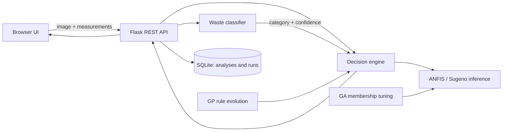

# EcoSort

EcoSort is an academic waste segregation and recycling decision-support system. It combines image classification, an interpretable Sugeno neuro-fuzzy model, tree-based genetic programming, and a genetic algorithm that tunes fuzzy membership functions.

## Architecture



The classifier, fuzzy inference, GP, and GA are separate modules. Classification weights and training data are optional. In demo mode the app identifies itself as a demo and never presents demo outputs as measured model accuracy. A pretrained MobileNetV2 backbone is used when available; a project-finetuned checkpoint is a separate artifact and is required before claiming EcoSort dataset accuracy.

## Project structure

```text
ecosort/
├── app.py, config.py, requirements.txt, README.md
├── backend/
│   ├── routes/                 # Flask API blueprints
│   ├── services/               # orchestration, reports, analytics
│   ├── database/               # SQLite schema and access
│   └── models/                 # classifier, ANFIS, fuzzy, GP, GA
├── frontend/                   # framework-free HTML/CSS/JS + Chart.js
├── data/{raw,processed,samples,synthetic}/
├── experiments/                # reproducible train/evaluate scripts
├── tests/
└── reports/{evaluation,sample_reports}/
```

## Dataset plan

Use TrashNet as the initial six-class image dataset (paper, cardboard, plastic, metal, glass, trash). EcoSort maps paper/cardboard to **Paper**, and its six-class target additionally includes **Organic** and **Electronic waste**. TrashNet alone therefore does not cover all EcoSort labels; obtain separately licensed, documented examples for organic and electronic waste or use TACO images only after reviewing its labels and license. Keep source datasets in `data/raw/<dataset-name>/`, preserve their license/attribution files, and never redistribute them unless the license permits it. Split by source image (and preferably source collection) into train/validation/test before augmentation to avoid leakage. Store the split manifest in `data/processed/`.

Expected training folder layout for the provided training script:

```text
data/processed/images/
├── train/{electronic_waste,glass,metal,organic,paper,plastic}/
├── val/{electronic_waste,glass,metal,organic,paper,plastic}/
└── test/{electronic_waste,glass,metal,organic,paper,plastic}/
```

Do not mix TrashNet's `trash` class into an EcoSort category without manually relabeling it. The classifier reports top-three probabilities and whether weights are pretrained, fine-tuned, or demo fallback. A pretrained ImageNet model is not a waste classifier until fine-tuned and evaluated on a held-out waste dataset.

## Roadmap

1. **Setup and data preparation:** package layout, configuration, data policy, and reproducible dataset instructions.
2. **CNN classification:** MobileNetV2 transfer-learning pipeline, checkpoint metadata, inference and correction capture.
3. **Fuzzy inference:** bounded membership functions, expert rules and explainable Sugeno outputs.
4. **ANFIS:** hybrid premise-gradient/consequent least-squares learning and fixed train/validation/test evaluation.
5. **Genetic programming:** executable typed rule trees, evolution operators and fitness history.
6. **Genetic algorithm:** constrained real-valued membership chromosomes and optional structure-preserving operators.
7. **Decision engine:** category-specific advice, uncertainty/conflict handling and unified explanation.
8. **Flask and SQLite:** validated APIs, persistence, history, analytics and reports.
9. **Frontend:** eight responsive pages connected to live APIs.
10. **Integration and documentation:** reliability checks, API/algorithm docs, diagrams, evaluation artifacts and viva notes.

## Run the application

Use Python 3.10 or newer.

```bash
python -m venv .venv
source .venv/bin/activate        # Windows: .venv\Scripts\activate
pip install -r requirements.txt
```

Dataset download is intentionally user-managed: follow the source dataset's current access and license terms, then arrange and split the images as above. No dataset is bundled, and no model accuracy is claimed in Phase 1.

For MobileNetV2 training, install an appropriate PyTorch/torchvision build (the `requirements-ml.txt` is a generic CPU starting point), then run:

```bash
python experiments/train_classifier.py --data data/processed/images --epochs 8
```

The trainer uses pretrained MobileNetV2 weights, selects a checkpoint by validation loss, and prints held-out test accuracy, precision, recall, F1 and confusion matrix. Results are specific to the provided split. Start the web app with `python app.py` and open `http://127.0.0.1:5000`.

The API supports labeled ANFIS training at `/api/anfis/train` with at least ten samples and a priority target from 0–100; it uses a fixed-seed train/validation/test split and reports held-out metrics. The API documentation is in [API.md](API.md). GP/GA demo fitness uses explicitly identified synthetic teaching targets, not measured recycling outcomes. Optimizer and trained ANFIS states currently live in memory until the server restarts.

## License and dataset notice

Code licensing and dataset licensing are separate. Verify the current license and attribution conditions of each dataset and pretrained weight source before academic or public redistribution.

## Deploy (Render)

The repository includes `render.yaml`, `wsgi.py` and `gunicorn`. On [render.com](https://render.com), choose **New → Blueprint**, select this GitHub repository and apply; Render builds with `pip install -r requirements.txt` and starts `gunicorn wsgi:app`. On the free plan the SQLite history and uploaded images are reset when the service restarts or redeploys, and the service sleeps after 15 minutes without traffic (the first request then takes about a minute).
